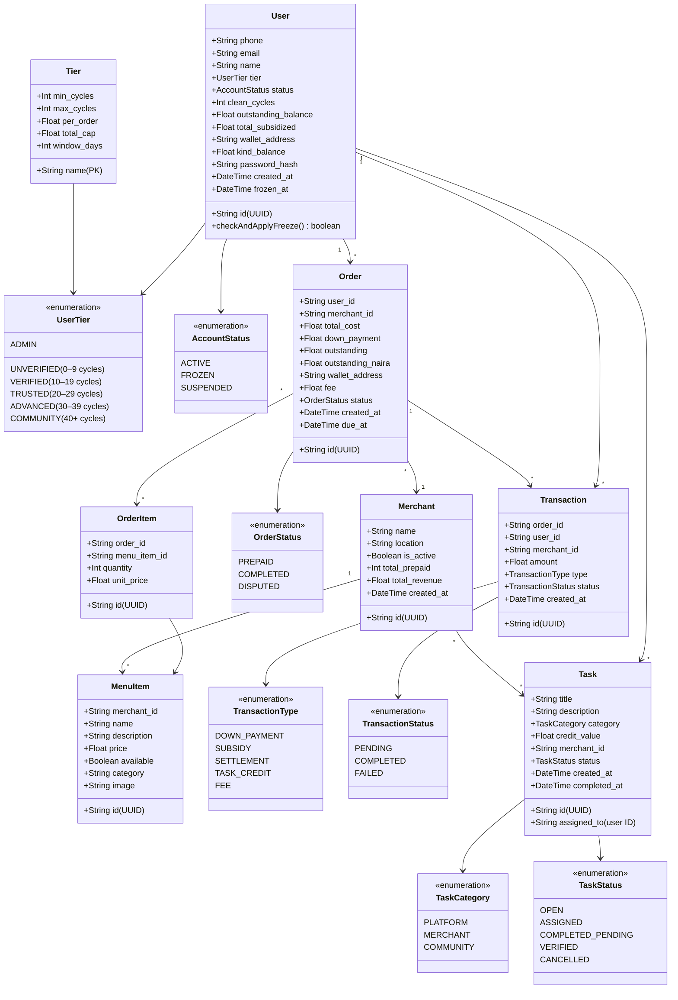
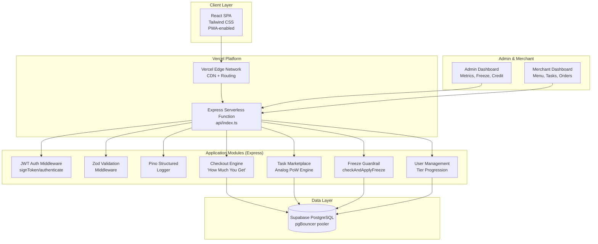
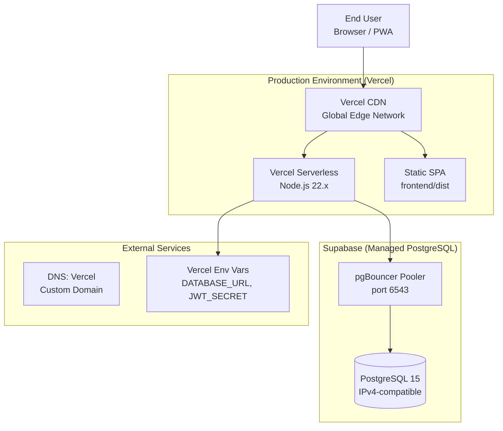
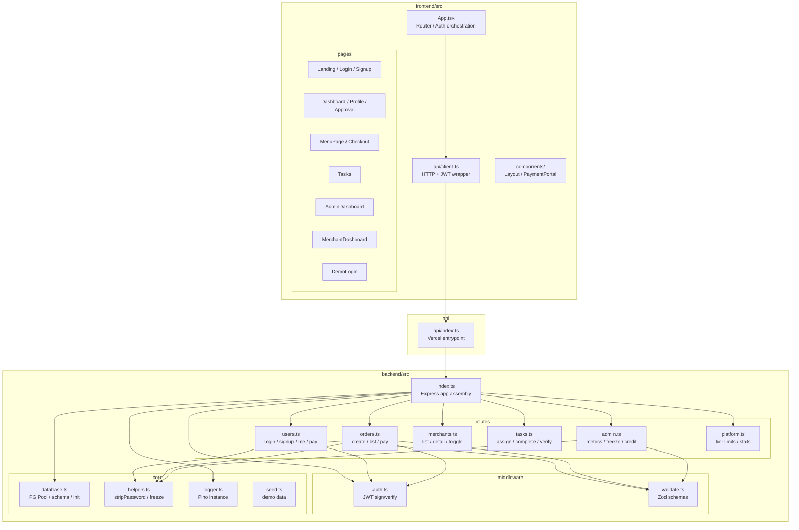
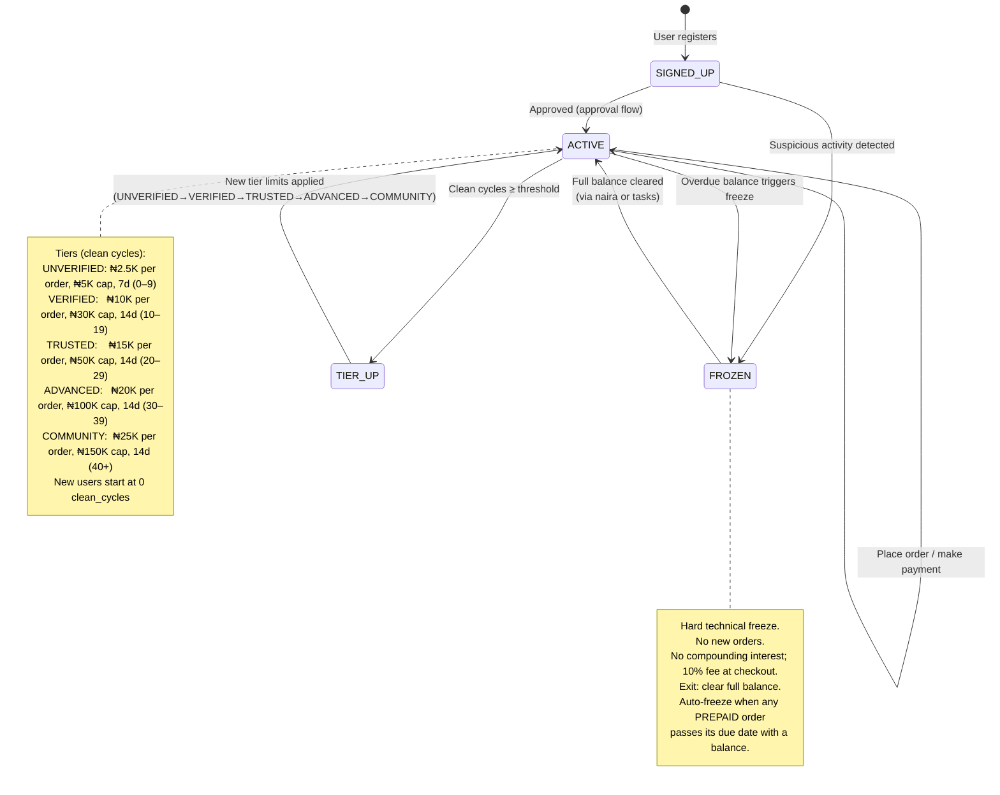
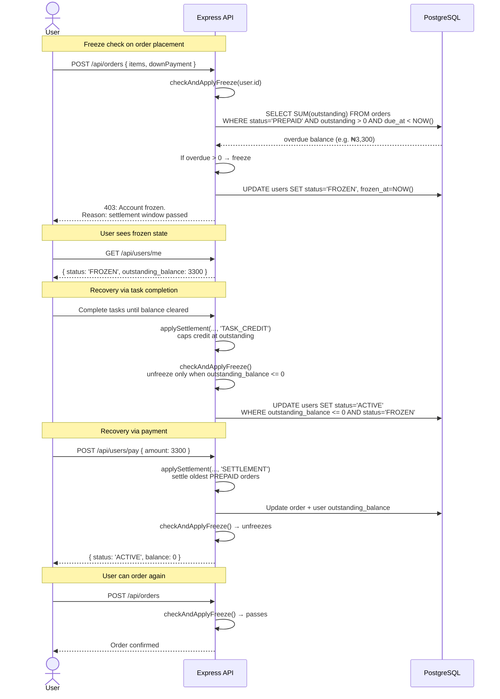
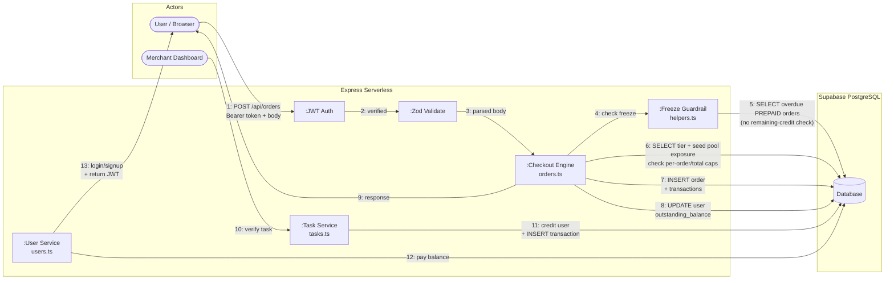
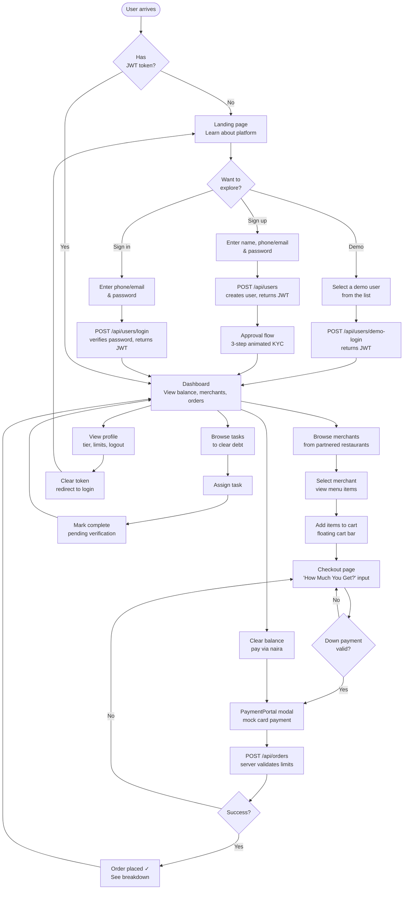

# Chop First — UML Diagrams (Production)

## 1. Structural Diagrams

### 1.1 Class Diagram — Core Domain Model



### 1.2 Component Diagram — System Architecture



### 1.3 Deployment Diagram — Infrastructure Topology



### 1.4 Module Diagram — Backend Source Structure



---

## 2. Behavioural Diagrams

### 2.1 Use Case Diagram — Actors & Features

```mermaid
graph TB
    subgraph "Chop First System"
        UC1("Sign Up<br/>(Phone/Email + Password)")
        UC2("Sign In<br/>(Credential + Password)")
        UC3("Browse Menu & Add to Cart")
        UC4("Place Subsidized Order<br/>'How Much You Get'")
        UC5("Make Full Payment<br/>(Skip Subsidy)")
        UC6("View Outstanding Balance<br/>& Cap Usage")
        UC7("Clear Balance via Naira")
        UC8("Browse & Complete Tasks<br/>(Analog PoW)")
        UC9("Progress to Next Tier")
        UC10("View Profile & Limits")
        UC11("Pay Specific Order")

        UC12("View Prepaid Tickets")
        UC13("Toggle Menu Item Availability")
        UC14("Verify Community Tasks")
        UC15("View Merchant Stats & Orders")

        UC16("View Platform Metrics")
        UC17("Freeze / Unfreeze Users")
        UC18("Process Manual Credits")
        UC19("View All Users")
    end

    User[End User / Seeker] --> UC1
    User --> UC2
    User --> UC3
    User --> UC4
    User --> UC5
    User --> UC6
    User --> UC7
    User --> UC8
    User --> UC9
    User --> UC10
    User --> UC11

    Merchant[Restaurant / Vendor] --> UC12
    Merchant --> UC13
    Merchant --> UC14
    Merchant --> UC15

    Admin[Platform Administrator] --> UC16
    Admin --> UC17
    Admin --> UC18
    Admin --> UC19
```



### 2.2 Sequence Diagram — Place Subsidized Order

```mermaid
sequenceDiagram
    actor User
    participant UI as React SPA
    participant API as Express API<br/>(Vercel)
    participant MID as Middleware<br/>Auth + Validate
    participant DB as PostgreSQL<br/>(Supabase)

    User->>UI: Browse menu & add items
    User->>UI: Tap "Proceed to Checkout"
    UI->>UI: Compute totals client-side
    User->>UI: Enter down payment (e.g. ₦1,500)
    User->>UI: Tap "Pay ₦1,500 — Start Order"
    UI->>UI: Show PaymentPortal mock card
    User->>UI: Tap "Pay" in portal
    UI->>UI: Processing animation (1.5s)

    UI->>API: POST /api/orders<br/>Authorization: Bearer &lt;JWT&gt;<br/>{ merchantId, items, downPayment }

    API->>MID: authenticate middleware
    MID->>MID: Verify JWT → req.user

    API->>MID: validate(schemas.createOrder)
    MID->>MID: Zod parse body

    API->>DB: SELECT user WHERE id = $1
    DB-->>API: user data

    API->>API: checkAndApplyFreeze(user.id)<br/>Any PREPAID order past due with balance?

    API->>DB: SELECT merchant WHERE id = $1 AND is_active = 1
    DB-->>API: merchant

    API->>DB: SELECT menu_items for each cart item
    DB-->>API: menu item data

    API->>API: Compute totalCost = Σ(price × qty)

    alt Full payment (downPayment = totalCost)
        API->>DB: INSERT order (COMPLETED, outstanding=0, due=now+window_days)
        API->>DB: INSERT transactions (DOWN_PAYMENT)
        API-->>UI: { status: COMPLETED, fullPayment: true }
    else Subsidized payment
        API->>API: subsidy = total - down<br/>fee = 10% × subsidy<br/>outstanding = subsidy + fee
        API->>DB: SELECT * FROM tiers WHERE UPPER(name) = UPPER(user.tier)
        DB-->>API: { per_order, total_cap, window_days }
        API->>API: Validate: subsidy ≤ per_order &&<br/>(currentOutstanding + outstanding) ≤ total_cap
        alt Limit exceeded
            API-->>UI: 400 error with<br/>required down payment
        else Within caps
            API->>DB: SELECT SUM(outstanding_balance) FROM users
            DB-->>API: current exposure
            alt Exposure + subsidy > 85% × seedPool
                API-->>UI: 503 error: seed-pool reserve reached
            else Reserve available
                API->>DB: INSERT order (PREPAID, outstanding_naira, wallet_address,<br/>due = now + window_days)
                API->>DB: INSERT order_items × N
                API->>DB: INSERT transactions (DOWN_PAYMENT, SUBSIDY, FEE)
                API->>DB: UPDATE user SET outstanding_balance += outstanding
                API->>DB: UPDATE merchant SET total_prepaid++, revenue += totalCost
                API-->>UI: { id, totalCost, downPayment, outstanding, fee, dueAt }
            end
        end
    end

    UI->>UI: Show success screen
    UI->>API: GET /api/users/me (refresh user state)
    API-->>UI: Updated user (debt, cycles, tier)
```

### 2.3 Sequence Diagram — Clear Balance via Analog PoW Task

```mermaid
sequenceDiagram
    actor User
    participant UI as React SPA
    participant API as Express API
    participant DB as PostgreSQL

    User->>UI: View balance (₦1,050 outstanding)
    UI->>API: GET /api/tasks<br/>Authorization: Bearer &lt;JWT&gt;
    API->>DB: SELECT tasks WHERE status='OPEN'<br/>OR assigned_to = userId
    DB-->>API: [Task A: ₦1,050, Task B: ₦700, ...]
    API-->>UI: tasks array

    User->>UI: Tap "Assign" on Task A
    UI->>API: POST /api/tasks/:id/assign
    API->>DB: UPDATE tasks SET assigned_to, status='ASSIGNED'
    DB-->>API: updated task
    API-->>UI: { status: ASSIGNED }

    User->>User: Complete task offline

    User->>UI: Tap "Mark Complete"
    UI->>API: POST /api/tasks/:id/complete
    API->>DB: UPDATE tasks SET status='COMPLETED_PENDING'
    API-->>UI: { message: 'Submitted for verification' }

    Note over Merchant: Merchant verifies in their dashboard
    Merchant->>API: POST /api/tasks/:id/verify
    API->>DB: UPDATE tasks SET status='VERIFIED'
    API->>API: applySettlement(userId, credit_value, 'TASK_CREDIT')<br/>Credit capped at outstanding; settle oldest PREPAID orders
    API->>DB: INSERT transaction (TASK_CREDIT)
    API->>API: Award clean cycle only if order settled by due_at
    API->>API: syncUserTier(clean_cycles)
    API->>API: Auto-unfreeze only when outstanding_balance <= 0
    API-->>Merchant: { message: 'Verified, balance credited' }

    User->>UI: Refresh dashboard
    UI->>API: GET /api/users/me
    API-->>UI: Updated user (outstanding: ₦0)
```

### 2.4 Activity Diagram — Order & Settlement Flow

```mermaid
flowchart TB
    Start([User opens Chop First]) --> Browse[Browse menu from<br/>partnered vendors]
    Browse --> Select[Select meal items]
    Select --> Total[View total cost<br/>e.g. ₦4,000]
    Total --> Prompt["How much you get?"<br/>Enter down payment]
    Prompt --> CheckFreeze{Account frozen?<br/>overdue balance?}

    CheckFreeze -->|FROZEN| Block[❌ Order blocked<br/>Clear balance first]
    Block --> End1([End])

    CheckFreeze -->|ACTIVE| Validate{Down payment<br/>≥ total?}

    Validate -->|Yes, full payment| Full[Process full payment<br/>No subsidy, no fee]
    Full --> Complete[✅ Order completed]

    Validate -->|No, partial| Calc[subsidy = total - down<br/>fee = 10% of subsidy<br/>outstanding = subsidy + fee]
    Calc --> Limits{Subsidy ≤ per_order?}

    Limits -->|No| Deny[❌ Order denied<br/>Increase down payment]
    Deny --> Prompt

    Limits -->|Yes| DebtCheck{Current outstanding + outstanding<br/>≤ total_cap?}
    DebtCheck -->|No| Deny2[❌ Would exceed total cap<br/>Increase down payment]
    Deny2 --> Prompt

    DebtCheck -->|Yes| PoolCheck{Exposure + subsidy<br/>≤ 85% seed pool?}
    PoolCheck -->|No| Deny4[❌ Seed pool reserve reached<br/>Try later]
    Deny4 --> End1

    PoolCheck -->|Yes| Insert[INSERT order (PREPAID)<br/>INSERT transactions<br/>UPDATE user debt]
    Insert --> Confirm[✅ Order placed]
    Confirm --> Remind[Reminder: Pay ₦X within N days]

    Remind --> Wait{User action<br/>within window?}

    Wait -->|Pay Naira| PayFull[User pays full outstanding]
    PayFull --> Settle[Settlement complete<br/>Clean cycle +1]

    Wait -->|Complete tasks| BrowseTask[Browse task marketplace]
    BrowseTask --> Assign[Assign & complete<br/>analog PoW task]
    Assign --> MerchantVer[Merchant verifies<br/>task completion]
    MerchantVer --> Credit[Task credited to balance]
    Credit --> Settle

    Wait -->|No action / due date passed| Freeze[⛔ Freeze Guardrail triggered]
    Freeze --> Inactive[Account set to FROZEN<br/>New orders blocked]
    Inactive --> Eventually[User eventually pays<br/>or completes tasks]
    Eventually --> Reactivate[Account reactivated<br/>on full balance clear]
    Reactivate --> Settle

    Settle --> TierCheck{clean_cycles<br/>range?}
    TierCheck -->|0–9| Tier0[Tier: UNVERIFIED<br/>Per-order: ₦2,500<br/>Total cap: ₦5,000<br/>Window: 7 days]
    TierCheck -->|10–19| Tier1[Tier: VERIFIED<br/>Per-order: ₦10,000<br/>Total cap: ₦30,000<br/>Window: 14 days]
    TierCheck -->|20–29| Tier2[Tier: TRUSTED<br/>Per-order: ₦15,000<br/>Total cap: ₦50,000<br/>Window: 14 days]
    TierCheck -->|30–39| Tier3[Tier: ADVANCED<br/>Per-order: ₦20,000<br/>Total cap: ₦100,000<br/>Window: 14 days]
    TierCheck -->|40+| Tier4[Tier: COMMUNITY<br/>Per-order: ₦25,000<br/>Total cap: ₦150,000<br/>Window: 14 days]
    Tier0 --> End2([End])
    Tier1 --> End2
    Tier2 --> End2
    Tier3 --> End2
    Tier4 --> End2
```

### 2.5 State Machine Diagram — User Account Lifecycle



### 2.6 Sequence Diagram — Freeze Guardrail Trigger & Recovery



### 2.7 Communication Diagram — Order Processing (Object Interaction)



### 2.8 User Flow Diagram — End-to-End Journey



---

## 3. Legend

| Icon/Notation | Meaning |
|---|---|
| `-->` | Dependency / Association |
| `-->>` | Async return / Callback |
| `--*` | Composition |
| `--o` | Aggregation |
| `<<enumeration>>` | Enum type |
| `[*]` | Initial / Final state |
| `@` | Actor (external entity) |
